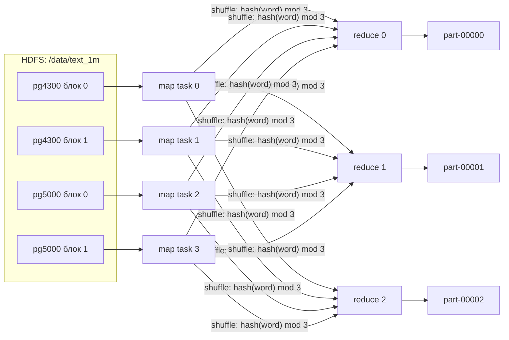

## Семинар 4. Хранение файлов: S3, Hadoop.

### Демо 1 - minio

1. Запустить minio - `docker-compose up -d`
2. Запустить среду и ноутбук - `cd env && sh env_setup.sh`
3. См. `minio_demo.ipynb`

### Демо 2 - hadoop

Базовые примеры.
Ниже - примеры для локального запуска

1. Поднимаем стенд: `docker-compose up -d`
Важно: дальше очень долго!
2. Кладем данные в namenode для работы с ними через HDFS CLI: `docker cp archive.zip namenode:archive.zip`
3. Второй файл: `docker cp breweries.csv namenode:breweries.csv`
4. Заходим в namenode и включаем bash: `docker exec -it namenode bash`
5. Выключаем read_only: `hdfs dfsadmin -safemode leave`
6. Создаем директорию: `hdfs dfs -mkdir -p /data/sem_example`
7. Листим в ней файлы: `hdfs dfs -ls /data`
8. Загружаем файл в HDFS: `hdfs dfs -put archive.zip /data/sem_example/archive.zip`
9. Смотрим информацию о файле в HDFS: `hdfs fsck /data/sem_example`
10. Загружаем файл в HDFS: `hdfs dfs -put breweries.csv /data/sem_example/breweries.csv`

Базовые примеры для spark:
1. `docker exec -it spark-master bash`
2. Запускаем pyspark в консольном режиме: `/spark/bin/pyspark --master spark://spark-master:7077`
3. Убеждаемся, что у нас есть spark context: `spark`
4. Готовим RDD из файла в HDFS: `df = spark.read.csv('hdfs://namenode:9000/data/sem_example/breweries.csv')`
5. Выполняем action: `df.show()`
6. Spark
```python
from pyspark.sql import SparkSession


spark = SparkSession.builder.getOrCreate()

df = spark.read \
    .option('header', 'true') \
    .csv('hdfs://namenode:9000/data/sem_example/breweries.csv')

df.groupby('state') \
    .count() \
    .repartition(1) \
    .write \
    .mode('overwrite') \
    .option('header', 'true') \
    .csv('hdfs://namenode:9000/data/sem_example/breweries_groupby_pySpark.csv')
```
7. MapReduce
```bash
docker cp mapper.py namenode:mapper.py
docker cp reducer.py namenode:reducer.py
docker cp pg4300.txt namenode:pg4300.txt
docker cp pg5000.txt namenode:pg5000.txt
```

```bash
hadoop jar /opt/hadoop-3.2.1/share/hadoop/tools/lib/hadoop-streaming-3.2.1.jar \
-file mapper.py     -mapper mapper.py \
-file reducer.py    -reducer reducer.py \
-input /data/text/* -output /data/text-output
```

```
hadoop jar /usr/lib/hadoop-mapreduce/hadoop-streaming-3.2.2.jar -file mapper.py     -mapper mapper.py -file reducer.py    -reducer reducer.py -input /data/text/* -output /data/text-output
```

Ниже - примеры для yandex cloud dataproc

1. `sudo -u hdfs hdfs dfs -mkdir -p /data/sem_example`
   `sudo -u hdfs hdfs dfs -chown -R ubuntu:hadoop /data`
2. `hdfs dfs -ls /data`
3. `hdfs dfs -put archive.zip /data/sem_example/archive.zip`
4. `hdfs dfs -ls /data/sem_example`
5. `hdfs fsck /data/sem_example`
6. `hdfs dfs -put breweries.csv /data/sem_example/breweries.csv`
7. `hdfs dfs -ls /data/sem_example`
8. `hdfs fsck /data/sem_example`
9. `/usr/bin/pyspark`
```python
df = spark \
    .read \
    .option('header', 'true') \
    .csv('hdfs://rc1d-dataproc-m-lklbj782udualp1r.mdb.yandexcloud.net:8020/data/sem_example/breweries.csv')
```
11.
```python
df.groupby('state') \
    .count() \
    .repartition(1) \
    .write \
    .mode('overwrite') \
    .option('header', 'true') \
    .csv('hdfs://rc1d-dataproc-m-lklbj782udualp1r.mdb.yandexcloud.net:8020/data/sem_example/breweries_groupby_pySpark.csv')
```
12.
```python
spark.read.option('header', 'true').csv('hdfs://rc1d-dataproc-m-lklbj782udualp1r.mdb.yandexcloud.net:8020/data/sem_example/breweries_groupby_pySpark.csv').show()
```
1.  `hdfs dfs -mkdir -p /data/text`
2.  `hdfs dfs -put pg4300.txt /data/text/pg4300.txt`
3.  `hdfs dfs -put pg5000.txt /data/text/pg5000.txt`
4.  `hdfs dfs -ls /data/text`
5.  
```bash
hadoop jar /usr/lib/hadoop-mapreduce/hadoop-streaming.jar \
  -files mapper.py,reducer.py \
  -mapper "python3 mapper.py" \
  -reducer "python3 reducer.py" \
  -input /data/text/* \
  -output /data/text-output
```
18.
```python
df = spark.read.csv('hdfs://rc1d-dataproc-m-lklbj782udualp1r.mdb.yandexcloud.net:8020/data/text-output', sep='\t')

df.sort(df._c1, ascending=False).show()
```

## Демо 2.1 - Hadoop на Yandex Data Proc: ver 2026/2027

Это сценарий демо с упором на наглядность. Исходная версия со списком команд лежит в [../README.md](../README.md).

| Концепт | Демо |
|---|---|
| Файл в HDFS режется на блоки | `block_map.py` рисует блоки и их заполненность |
| Нарезка идёт по байтам, а не по строкам | `block_boundary.py` показывает строку, разрезанную между блоками |
| Каждый блок хранится в нескольких репликах | матрица «блок × DataNode», `-setrep`, `du` с учётом реплик |
| Проблема маленьких файлов | один zip против 2000+ мелких файлов: сравниваем число блоков |
| Map → Shuffle/Sort → Reduce | `mr_local_steps.sh` проходит все шаги обычным пайпом |
| 1 сплит ≈ 1 блок ≈ 1 mapper, data locality | map-only job со `split_inspector.py` сообщает, что прочитал каждый mapper |
| Партиционирование между reducer-ами | 3 reducer-а дают 3 файла `part-*`, каждое слово ровно в одном из них |
| Combiner экономит shuffle | `counters.py` ставит счётчики двух запусков рядом |

```
tools/
├── block_map.py        # карта блоков и реплик по выводу hdfs fsck
├── block_boundary.py   # что лежит на границе блоков
├── mr_local_steps.sh   # MapReduce по шагам на ноутбуке / master-ноде
├── split_inspector.py  # маппер-«шпион» для map-only job
└── counters.py         # сравнение счётчиков Hadoop job-ов
```

---

### 0. Подготовка кластера

**Конфигурация.** Для наглядной репликации нужно **≥ 3 хостов в подкластере Data** (там живут DataNode). Если DataNode всего одна, все реплики «лежат в одном месте» и половина демо теряет смысл.
Сервисы: `HDFS`, `YARN`, `MAPREDUCE`, `SPARK`. Включите опцию **UI Proxy**, тогда в консоли появятся ссылки на веб-интерфейсы NameNode, YARN и JobHistory.

**Копируем материалы на master-ноду** (с ноутбука, из папки `week04/sem/demo2_hadoop`):

```bash
MASTER=<some-fqdn>.mdb.yandexcloud.net
scp -r tools map_reduce_example breweries.csv ubuntu@$MASTER:~/
scp archive.zip ubuntu@$MASTER:~/
ssh ubuntu@$MASTER
```

**На master-ноде** выдаём себе права на `/data` и заводим переменную с путём к streaming jar:

```bash
sudo -u hdfs hdfs dfs -mkdir -p /data
sudo -u hdfs hdfs dfs -chown -R ubuntu:hadoop /data
export STREAMING=/usr/lib/hadoop-mapreduce/hadoop-streaming.jar
```

> Полное имя хоста `hdfs://rc1d-...:8020` писать не обязательно: `/data/...` резолвится через `fs.defaultFS`.
> Посмотреть его можно командой `hdfs getconf -confKey fs.defaultFS`.

---

### 1. Смотрим на кластер

```bash
hdfs getconf -confKey dfs.blocksize      # 268435456 = 256 МБ (в «ванильном» Hadoop было бы 134217728 = 128 МБ)
hdfs getconf -confKey dfs.replication    # 1 (!) - на Data Proc реплик по умолчанию ОДНА
sudo -u hdfs hdfs dfsadmin -report | grep -E "^Name|^Hostname|DFS Used%|Live datanodes"
yarn node -list                          # NodeManager-ы, на которых будут крутиться map/reduce task-и
```

> **Дефолты Data Proc, о которые легко споткнуться** (проверено на кластере с 3 DataNode, Hadoop 3.3.2):
> - `dfs.replication = 1`. `hdfs dfs -setrep -R 3 /data` на пустой папке ничего не меняет, а новые файлы всё равно лягут в одной реплике.
>   Поэтому во всех загрузках ниже явно стоит `-D dfs.replication=3`.
> - `dfs.blocksize = 256 МБ`. Чтобы числа в README (6 блоков у `archive.zip`) сошлись, там явно стоит `-D dfs.blocksize=134217728`.
> - `mapreduce.job.maps = 30` (`hdfs getconf -confKey mapreduce.job.maps`). Streaming использует старый API, где это число - подсказка для нарезки сплитов:
>   `goalSize = размер_входа / 30`, и сплиты получаются **меньше блока** (вместо 4 mapper-ов получится 31). Поэтому в job-ах ниже стоит `-D mapreduce.job.maps=1`.
> - `mapreduce.map.output.compress = true`: выход mapper-ов сжимается, и `Reduce shuffle bytes` в разделе 5.4 получается в разы меньше «честных» байт, поэтому там стоит `-D mapreduce.map.output.compress=false`.

```
                 ┌──────────── master ────────────┐
                 │ NameNode: «какие блоки у файла │
                 │  и на каких нодах они лежат»   │
                 │ ResourceManager (YARN)         │
                 └───────────────┬────────────────┘
          metadata / heartbeat   │   (данные через master НЕ идут)
       ┌─────────────────────────┼─────────────────────────┐
┌──────┴──────┐           ┌──────┴──────┐           ┌──────┴──────┐
│ data-1      │           │ data-2      │           │ data-3      │
│ DataNode    │◄─────────►│ DataNode    │◄─────────►│ DataNode    │  блоки + реплики
│ NodeManager │           │ NodeManager │           │ NodeManager │  map/reduce task-и
└─────────────┘           └─────────────┘           └─────────────┘
```

Параллельно откройте в UI Proxy **HDFS NameNode UI → Datanodes**, чтобы видеть живые ноды и их заполненность.

---

### 2. Блоки

#### 2.1 Маленький блок, чтобы было что разглядывать

Блок по умолчанию 256 МБ (на Data Proc), а книги весят по 1.5 МБ. Поэтому загрузим их с блоком **1 МБ** (минимально допустимый размер):

```bash
hdfs dfs -mkdir -p /data/text /data/text_1m

# обычная загрузка: блок по умолчанию (256 МБ), 3 реплики
hdfs dfs -D dfs.replication=3 -put map_reduce_example/pg4300.txt map_reduce_example/pg5000.txt /data/text/

# та же загрузка, но блок 1 МБ
hdfs dfs -D dfs.replication=3 -D dfs.blocksize=1048576 -put map_reduce_example/pg4300.txt map_reduce_example/pg5000.txt /data/text_1m/

hdfs dfs -stat "%n  size=%b  blocksize=%o  replication=%r" /data/text/* /data/text_1m/*
```

#### 2.2 Карта блоков

```bash
python3 tools/block_map.py /data/text
python3 tools/block_map.py /data/text_1m
```

Примерно так будет выглядеть вывод:

```
📄 /data/text_1m/pg4300.txt   1.5 MB   2 block(s)   blocksize≈1.0 MB   replication=3
     #  block            заполненность блока        size   dn1   dn2   dn3
     0  blk_1073741831   ████████████████████     1.0 MB   ●     ●     ●
     1  blk_1073741832   ██████████··········   525.2 KB   ●     ●     ●
```

На что обратить внимание:
- последний блок **не дополняется** до полного размера. Блок 256 МБ с 1.5 МБ данных занимает на диске 1.5 МБ;
- у каждого блока свой `blk_<id>`. NameNode хранит соответствие «файл → блоки → ноды», а данные лежат только на DataNode.
- сразу после `put` NameNode может ещё не знать про последнюю реплику, и `block_map.py` покажет `⚠ реплик 2 из 3`. Это не поломка: повторите команду через несколько секунд.

То же самое в UI: **NameNode UI → Utilities → Browse the file system → /data/text_1m → клик по файлу**. В выпадающем списке *Block information* выбирается блок и видны его Block ID, размер и ноды.

#### 2.3 Большой файл

```bash
hdfs dfs -mkdir -p /data/sem_example
hdfs dfs -D dfs.replication=3 -D dfs.blocksize=134217728 -put archive.zip /data/sem_example/archive.zip
python3 tools/block_map.py /data/sem_example/archive.zip
```

Получится 6 блоков: 5 полных по 128 МБ и хвост ~17 МБ. (С блоком по умолчанию, 256 МБ, было бы 3 блока: 256 + 256 + 145 МБ.)

При 3 DataNode и `replication=3` каждый блок лежит на **всех** нодах, поэтому в матрице везде `● ● ●`. Чтобы увидеть, что реплики разных блоков раскиданы по разным нодам, понизьте репликацию до 2 (на 3 нодах у каждого блока будет два `●` из трёх):

```bash
hdfs dfs -setrep -w 2 /data/sem_example/archive.zip
python3 tools/block_map.py /data/sem_example/archive.zip
hdfs dfs -setrep -w 3 /data/sem_example/archive.zip    # вернуть
```

#### 2.4 Граница блока проходит где угодно

HDFS ничего не знает про строки, CSV и слова: он режет поток байт каждые `blocksize` байт.

```bash
python3 tools/block_boundary.py /data/text_1m/pg4300.txt
python3 tools/block_boundary.py /data/text_1m/pg5000.txt
```

```
Граница блока 0 | блока 1  (смещение 1048576 байт)
serve the Sultan, who‖ sought to engage him, by means of certain
-> строка разрезана: её начало в блоке 0, конец - в блоке 1
```

Отсюда вопрос к аудитории: *mapper получает строку целиком или половинку?* Ответ даст раздел 5.2.

#### 2.5 (опционально) Блок - это обычный файл на диске DataNode

```bash
# на ноутбуке: ssh с agent forwarding, чтобы с master-а можно было зайти на data-ноды.
# Ключ должен лежать в ssh-agent, иначе на data-ноде будет Permission denied (publickey):
ssh-add -l || ssh-add ~/.ssh/id_ed25519              # подставьте свой ключ
ssh -A ubuntu@$MASTER
hdfs getconf -confKey dfs.datanode.data.dir          # где DataNode хранит блоки: file:///hadoop/dfs/data
python3 tools/block_map.py /data/text_1m/pg4300.txt  # взять id блока #0 и IP любой ноды из секции DataNodes
ssh <IP data-ноды>                                   # по короткому имени из block_map зайти не получится: оно не резолвится
sudo find /hadoop/dfs/data -name 'blk_<id>*'         # сам блок + .meta с чексуммами (find / идёт ~1 минуту)
sudo tail -c 200 <путь к blk_<id>>                    # конец блока #0 - та самая разрезанная строка
```

Ожидаемо: файл `blk_<id>` ровно 1048576 байт, а `tail` заканчивается на `teats to his avid ` (дальше, в блоке #1, идёт `suction. Ant milks aphis...`).

---

### 3. Репликация

#### 3.1 Реплики занимают место

```bash
hdfs dfs -du -h -s /data/sem_example/archive.zip
# 657.4 M  1.9 G  /data/sem_example/archive.zip
#   ^ данные  ^ место на дисках кластера = данные × replication
```

#### 3.2 Меняем фактор репликации на лету

```bash
F=/data/text_1m/pg4300.txt

hdfs dfs -setrep -w 1 $F        # -w ждёт, пока NameNode удалит лишние реплики
python3 tools/block_map.py $F   # у каждого блока одна точка ●

hdfs dfs -setrep -w 3 $F        # DataNode-ы копируют блоки друг другу
python3 tools/block_map.py $F   # снова три ● (нод ровно три, так что реплики на всех)
```

#### 3.3 Реплик хотим больше, чем есть нод

```bash
hdfs dfs -setrep 10 $F          # БЕЗ -w, иначе команда будет ждать вечно
python3 tools/block_map.py $F   # ⚠ реплик 3 из 10
hdfs fsck $F | grep -iE "under.?replicated|Target Replicas"
hdfs dfs -setrep 3 $F           # вернуть как было
```

Вывод: две реплики одного блока никогда не кладутся на одну и ту же DataNode, поэтому реплик не может быть больше, чем нод.

#### 3.4 Фактор репликации задаётся на уровне файла

```bash
hdfs dfs -D dfs.replication=1 -put breweries.csv /data/sem_example/breweries_r1.csv
hdfs dfs -D dfs.replication=3 -put breweries.csv /data/sem_example/breweries.csv
hdfs dfs -ls /data/sem_example          # 2-я колонка = replication конкретного файла: 1 у breweries_r1.csv, 3 у остальных
```

(Если не указывать `-D dfs.replication` у второго `put`, на Data Proc он тоже получит 1: это значение по умолчанию.)

---

### 4. Проблема маленьких файлов

```bash
python3 -m zipfile -e archive.zip archive_unzipped/      # unzip может не оказаться на хосте
hdfs dfs -D dfs.replication=3 -put archive_unzipped /data/small_files   # ~1 минута: по RPC на каждый файл

hdfs dfs -count -h /data/sem_example/archive.zip /data/small_files
python3 tools/block_map.py /data/sem_example/archive.zip
python3 tools/block_map.py /data/small_files --max-files 3
```

| | `archive.zip` | `/data/small_files` |
|---|---|---|
| данных | ~657 МБ | примерно столько же |
| файлов | 1 | 2 275 (половина из них - macOS-мусор `__MACOSX/._*` по 100-300 байт) |
| блоков | 6 | 2 275, в среднем ~300 КБ |

> Сразу после такой загрузки `block_map.py` покажет «на дисках кластера с репликами x2.5», а `hdfs fsck /data/small_files` - `Under-replicated blocks` в десятки процентов:
> для тысяч мелких блоков NameNode узнаёт про реплики и дореплицирует их постепенно, на это уходит 10-15 минут. Это не ошибка, к блокам и файлам из таблицы отношения не имеет.

Каждый файл и каждый блок - это объект в **памяти NameNode** (~150 байт на объект). А при обработке каждый маленький файл становится отдельным сплитом и отдельным mapper-ом. Отсюда практическое правило: складывать в HDFS крупные файлы (Parquet/ORC/архивы), а не миллионы мелких.

---

### 5. MapReduce

#### 5.1 Сначала без Hadoop: те же mapper/reducer обычным пайпом

```bash
bash tools/mr_local_steps.sh
```

Скрипт по шагам печатает:

```
=== 1. MAP ===               to 1 / be 1 / or 1 / not 1 / to 1 / ...
=== 2. SHUFFLE & SORT ===    be 1 / be 1 / dream 1 / ... / to 1 / to 1 / to 1 / to 1
=== 3. REDUCE ===            be 2 / ... / to 4
=== БЕЗ shuffle/sort ===     to 1 / ... / to 1   <- reducer сломался: ключи идут вразнобой
=== PARTITION ===            reducer-0: question, sleep, that, the, to ...  reducer-1: be, dream, is ...
=== COMBINER ===             15 пар -> 11 пар
```

Главная мысль: **Hadoop Streaming - это `mapper | sort | reducer`**, только mapper-ов много, они запускаются рядом с блоками, а `sort` выполняется распределённо (shuffle).



#### 5.2 Сплиты = блоки: map-only job со «шпионом»

`split_inspector.py` ничего не считает, а сообщает, какой кусок файла достался mapper-у и на какой ноде он работал.
`mapreduce.job.reduces=0` делает job map-only: shuffle нет, и каждый mapper сам пишет свой `part-*`.
`mapreduce.job.maps=1` нужен из-за дефолта кластера `mapreduce.job.maps=30` (см. раздел 1): без него streaming нарежет вход на 31 сплит по ~100 КБ вместо 4 сплитов по границам блоков.

```bash
hdfs dfs -rm -r -f /data/out/splits
hadoop jar $STREAMING \
  -D mapreduce.job.reduces=0 \
  -D mapreduce.job.maps=1 \
  -D mapreduce.job.name="split inspector" \
  -files tools/split_inspector.py \
  -mapper "python3 split_inspector.py" \
  -input /data/text_1m \
  -output /data/out/splits

hdfs dfs -ls /data/out/splits                             # part-0000N по одному на mapper
hdfs dfs -cat /data/out/splits/part-* | column -t -s $'\t'
python3 tools/block_map.py /data/text_1m                  # сравнить host mapper-а с нодами блока
```

```
m_000000  rc1d-dataproc-d-aesph…  pg4300.txt  start=0        length=1048576  lines=22927  first=[The Project Gutenberg eBook of Uly…]  last=[teats to his avid suction. Ant mil…]
m_000001  rc1d-dataproc-d-aesph…  pg5000.txt  start=0        length=1048576  lines=23093  first=[The Project Gutenberg eBook of The…]  last=[serve the Sultan, who sought to en…]
m_000002  rc1d-dataproc-d-72alr…  pg4300.txt  start=1048576  length=537806   lines=10289  first=[rules the world. In life. In death.]   last=[]
m_000003  rc1d-dataproc-d-hnipp…  pg5000.txt  start=1048576  length=385401   lines=9694   first=[Franciscan Monks, for the purpose …]   last=[]
```

(Имена хостов и порядок могут отличаться: номера task-ов выдаются по убыванию размера сплита, так что два полных сплита идут раньше двух «хвостов».)

Что видно:
1. **4 блока → 4 сплита → 4 mapper-а.** Для сравнения запустите тот же job на `/data/text` (блок 256 МБ): mapper-ов будет 2, по одному на файл.
2. `start` совпадает с границей блока (`k × 1048576`).
3. Последняя строка `m_000000` целая, хотя физически её хвост лежит во втором блоке: mapper **дочитывает** строку из следующего блока. Первая строка сплита со `start=1048576` (`m_000002`, продолжение `pg4300.txt`) - следующая после разреза. Это делает `LineRecordReader`, и так закрывается вопрос из п. 2.4.
4. `host` mapper-а совпадает с одной из нод, где лежит реплика блока. Это **data locality**: код везут к данным, а не данные к коду. (Здесь это выполняется «тривиально»: при `replication=3` на 3 нодах реплики есть на каждой ноде, и счётчик `Data-local map tasks` всегда равен числу mapper-ов.)

#### 5.3 WordCount с тремя reducer-ами: партиции

```bash
hdfs dfs -rm -r -f /data/out/wc
hadoop jar $STREAMING \
  -D mapreduce.job.reduces=3 \
  -D mapreduce.job.maps=1 \
  -D mapreduce.map.output.compress=false \
  -D mapreduce.map.speculative=false \
  -D mapreduce.job.name="wordcount" \
  -files map_reduce_example/mapper.py,map_reduce_example/reducer.py \
  -mapper "python3 mapper.py" \
  -reducer "python3 reducer.py" \
  -input /data/text_1m \
  -output /data/out/wc 2>&1 | tee wc.log

hdfs dfs -ls /data/out/wc                                 # _SUCCESS + part-00000..00002
```

Каждое слово оказалось ровно в одном файле, а внутри файла ключи отсортированы:

```bash
for f in $(hdfs dfs -ls -C /data/out/wc/part-*); do
  echo "== $f: $(hdfs dfs -cat $f | wc -l) слов, первые ключи:"
  hdfs dfs -cat $f 2>/dev/null | head -3        # 2>/dev/null: иначе head оборвёт cat и тот напишет "Unable to write to output stream"
  hdfs dfs -cat $f 2>/dev/null | grep -P '^the\t' && echo "   ^^^ слово 'the' попало сюда"
done
```

Глобального порядка между файлами нет, поэтому общий топ собираем отдельно:

```bash
hdfs dfs -cat /data/out/wc/part-* | sort -t$'\t' -k2,2nr | head -10
```

#### 5.4 Combiner и счётчики

Сумма ассоциативна, поэтому `reducer.py` можно запустить ещё и как **combiner**: он схлопнет пары на стороне mapper-а до отправки по сети.

```bash
hdfs dfs -rm -r -f /data/out/wc_combiner
hadoop jar $STREAMING \
  -D mapreduce.job.reduces=3 \
  -D mapreduce.job.maps=1 \
  -D mapreduce.map.output.compress=false \
  -D mapreduce.map.speculative=false \
  -D mapreduce.job.name="wordcount + combiner" \
  -files map_reduce_example/mapper.py,map_reduce_example/reducer.py \
  -mapper "python3 mapper.py" \
  -combiner "python3 reducer.py" \
  -reducer "python3 reducer.py" \
  -input /data/text_1m \
  -output /data/out/wc_combiner 2>&1 | tee wc_combiner.log

python3 tools/counters.py wc.log wc_combiner.log
```

```
counter                           wc.log wc_combiner.log   что это
Launched map tasks                     4               4   сколько mapper-ов (≈ сплитов/блоков)
Data-local map tasks                   4               4   mapper запущен там же, где лежит блок
Launched reduce tasks                  3               3   сколько reducer-ов (= файлов part-*)
Map input records                 66 003          66 003   строк прочитано
Map output records               520 921         520 921   пар (word, 1) от mapper-ов
Combine input records                  0         520 921   пар вошло в combiner
Combine output records                 0          98 438   пар вышло из combiner-а
Reduce shuffle bytes           5 018 029       1 209 851   байт передано по сети в shuffle
Reduce input records             520 921          98 438   пар дошло до reducer-ов
Reduce input groups               73 328          73 328   уникальных ключей (слов)
Reduce output records             73 328          73 328   строк в результате
```

Результат одинаковый (`diff` двух `part-*` после `sort` пустой), а по сети прошло в ~4 раза меньше байт (5.0 МБ → 1.2 МБ) и в ~5 раз меньше пар (520 921 → 98 438). Точные байты слегка плавают от запуска к запуску.

Три замечания к цифрам:
- `Reduce input groups = 73 328`, а не 73 329, как насчитает Python локально: у обеих книг в начале файла стоит BOM, `LineRecordReader` его отбрасывает, и слово `The` из первой строки не превращается в отдельный ключ `The`.
- Флаги `-D mapreduce.map.output.compress=false` и `-D mapreduce.map.speculative=false` в обоих запусках нужны, чтобы цифры были честными и воспроизводимыми. На Data Proc выход mapper-ов по умолчанию сжимается, и тогда `Reduce shuffle bytes` для этих запусков - 572 КБ и 512 КБ: список `(word, 1)` сжимается так хорошо, что выигрыш combiner-а в байтах почти не виден (зато `Reduce input records` падает так же в 5 раз).
  Speculative execution иногда запускает лишний (потом убитый) mapper, и `Launched map tasks` становится 5.
- `Combine input/output records` в `wc.log` равны 0, а не «-»: Hadoop печатает эти счётчики и без combiner-а.

Те же job-ы можно открыть в **YARN ResourceManager UI → application → History** (JobHistory): там видны отдельные map/reduce attempt-ы, их ноды, длительность и все счётчики.

---

### 6. Тот же механизм в Spark (коротко)

```bash
pyspark
```

```python
sc = spark.sparkContext

# RDD читает HDFS через тот же InputFormat, что и MapReduce: партиция = сплит ≈ блок
sc.textFile('/data/text/pg4300.txt', 1).getNumPartitions()      # 1  (блок 256 МБ)
sc.textFile('/data/text_1m/pg4300.txt', 1).getNumPartitions()   # 2  (блок 1 МБ)
sc.textFile('/data/text_1m', 1).getNumPartitions()              # 4

# По умолчанию после shuffle партиций 200, а Spark 3 (AQE) сам схлопывает их в одну, и в HDFS окажется один part-файл.
# Чтобы разница между «по партиции на файл» и repartition(1) была видна, отключим AQE и возьмём 4 партиции:
spark.conf.set('spark.sql.adaptive.enabled', 'false')
spark.conf.set('spark.sql.shuffle.partitions', '4')

df = spark.read.option('header', 'true').csv('/data/sem_example/breweries.csv')
agg = df.groupby('state').count()
agg.explain()        # Exchange hashpartitioning(state, 4) - это и есть shuffle

agg.write.mode('overwrite').option('header', 'true').csv('/data/out/breweries_by_state')
agg.repartition(1).write.mode('overwrite').option('header', 'true').csv('/data/out/breweries_by_state_1')
```

```bash
hdfs dfs -ls /data/out/breweries_by_state     # 4 файла part-*: по файлу на партицию
hdfs dfs -ls /data/out/breweries_by_state_1   # один part-*
```

---

### 7. Уборка

```bash
hdfs dfs -rm -r -skipTrash /data/text /data/text_1m /data/out /data/small_files /data/sem_example
rm -rf archive_unzipped wc.log wc_combiner.log
```

---

### Шпаргалка

| Команда | Зачем |
|---|---|
| `hdfs fsck <path> -files -blocks -locations` | блоки файла и ноды с репликами |
| `hdfs dfs -stat "%b %o %r" <file>` | размер, blocksize, replication |
| `hdfs dfs -D dfs.blocksize=N -put ...` | загрузить с нестандартным размером блока |
| `hdfs dfs -D dfs.replication=N -put ...` | загрузить с нестандартной репликацией |
| `hdfs dfs -setrep [-w] N <path>` | поменять репликацию существующего файла |
| `hdfs dfs -du -h -s <path>` | логический размер и место с учётом реплик |
| `hdfs dfs -count -h <path>` | число директорий, файлов, байт |
| `sudo -u hdfs hdfs dfsadmin -report` | состояние DataNode-ов |
| `yarn application -list -appStates ALL` | список job-ов |
| `yarn logs -applicationId <id>` | логи task-ов (stderr mapper-ов и reducer-ов) |
